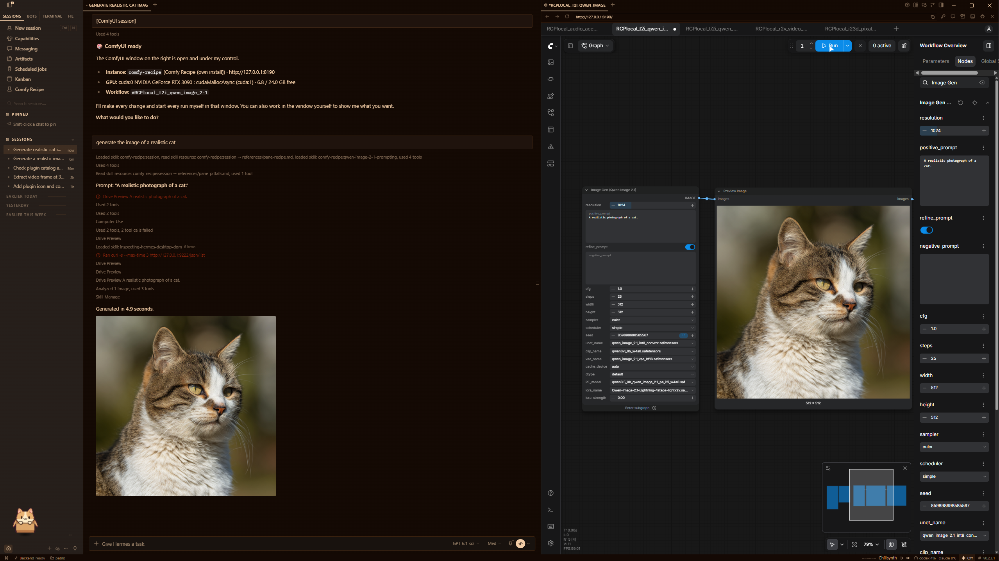

# Comfy Recipe

A community Hermes Agent plugin for visible ComfyUI sessions beside the chat, consent-based managed setup,
workflow discovery and readiness checks, background runs, timing reports and ffmpeg media preparation.



## Requirements and installation

- Hermes Agent **0.23.1 or later**; Hermes Desktop for visible sessions.
- A managed or existing ComfyUI, workflow-specific models/custom nodes and suitable hardware.
- ffmpeg/ffprobe for media operations; external comfy-cli only for headless UI-workflow conversion.
- Cloud workflows require ComfyUI's sign-in and credits. Installing a workflow never authorizes a paid run.

```bash
hermes plugins install dotroza/hermes-comfy-recipe
hermes plugins enable comfy-recipe
```

Fully restart Hermes, then use **Ctrl/⌘+K → Reload desktop plugins** and enable **Comfy Recipe** in
**Settings → Plugins**. Open Comfy Recipe from the sidebar. Setup asks before installing its own ComfyUI or
using an existing instance, and asks separately before extra node/model downloads and frontend settings.

Nine tools: `comfy_setup`, `comfy_onboarding`, `comfy_downloads`, `comfy_instances`, `comfy_workflows`,
`comfy_templates`, `comfy_run`, `comfy_result` and `comfy_media`. Includes `/comfy`, a `pre_llm_call` hook,
twelve focused skills, ten shared workflows, a four-step tutorial and live desktop progress cards.

## Security and privacy disclosures

- **Network:** probes localhost and configured ComfyUI servers; sends workflows/prompts/inputs to the selected
  server. Managed setup contacts official GitHub sources for ComfyUI and uv, Python distributions through uv,
  Python package indexes and PyTorch's index. Model links come from workflows or explicit requests (bundled links
  use Hugging Face/CDNs). ComfyUI-Manager contacts registries and node-pack sources. Cloud generation sends
  prompts/media to the selected provider only after explicit paid-run approval.
- **Downloaded code:** reuses installed uv or downloads official **uv 0.13.7**, checking the archive against
  SHA-256 pins committed in `installer.py` before copying its executable. uv installs Python 3.13 and resolves
  dependencies in the separate managed environment. ComfyUI follows the latest release tag, with a default-branch
  fallback if lookup fails. Approved custom nodes execute upstream code with the user's permissions; not sandboxed.
- **Local access:** discovers process command lines, Desktop/StabilityMatrix settings, selected ComfyUI metadata,
  workflows, model inventories and model-sharing paths. Reads selected media; writes derived media beside the
  source and optionally copies it to ComfyUI input. Publishes protected workflow copies/startup support to the
  managed installation; publishing into existing instances is explicit. Approved frontend settings use ComfyUI's
  API. Cosmetic session naming uses public `SessionDB` methods against the active profile's `state.db`.
- **Commands/processes:** runs uv, Python, git when available, hardware/process utilities, external comfy-cli,
  ffmpeg/ffprobe; installer/download/node workers and ComfyUI can outlive the chat turn. A watchdog normally stops
  only the managed ComfyUI when Hermes owners exit; `stop_with_hermes=false` keeps it running. Logs/progress stay local.
- **Stored data:** setup/instance paths, tutorial/download state, timing/run logs and contact sheets. Headless
  records include prompts/overrides; ComfyUI output metadata may include workflows/prompts. Tutorial matching
  stores a prompt hash. Reset does not delete these files or generated outputs.
- **Credentials:** no declared secret settings, required environment credentials or OAuth client. No credential-store
  reads or token-refresh implementation. Cloud authentication stays in ComfyUI's official API-node sign-in UI;
  do not give passwords or tokens to the agent.
- **Approvals/telemetry/updates:** no approval bypass, added telemetry, usage reporting or self-updating plugin code.
  Missing interactive clarification falls back to a chat question and waits for an answer. Catalog updates require
  a maintainer-reviewed SHA bump. Upstream ComfyUI, nodes and providers have independent policies.

Windows 11 is verified; macOS/Linux paths are implemented but not live-verified. Offline tests do not prove every
workflow/provider or fresh installation. Pane opening uses the agent's public `desktop_preview` tool, not a private
renderer event. Session-title failures retain Hermes' default naming.

[Full guide and settings](../README.md) · [Onboarding](../docs/ONBOARDING.md) ·
[Workflow library](../docs/WORKFLOW_LIBRARY.md) · [Submission checklist](../docs/CATALOG_SUBMISSION.md)

## Licence

MIT. External comfy-cli is a separate GPL-3.0 program; no comfy-cli source is bundled here.
